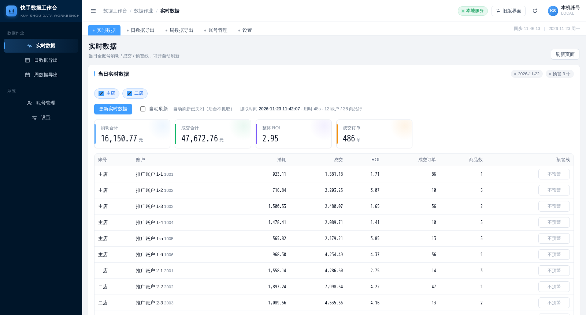
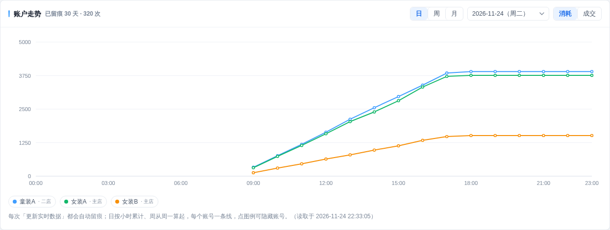

# 个人定制数据工作台

> 本地运行的投放数据工作台：抓取 · 留痕 · 导出 · 合并，数据只留在自己电脑上。

[](https://github.com/ShiMi-y/personal-data-workbench/releases/latest)
[](#快速开始)
[](#方式二源码运行)

面向快手小店投放（主店 / 二店多账号）的日常数据整理工具，把「登录后台 → 抄消耗成交 → 填月度 Excel」
这条重复链路自动化：一键抓取当日或历史数据、实时留痕看走势、按日 / 周导出、合并进月度表并跑 9 项自检，
出错不写坏原表。自带本地 Web 界面（新版 + 旧版可切换）、托盘常驻、定时自动刷新、消耗预警线和增量升级。

- **数据不出本机**：所有请求只走本机 → 平台，数据落在程序目录的 `data/`，不上传任何服务器；
- **不破坏原表结构**：合并只写「消耗」「成交」，表头、日期列、总计行、ROI 公式一律不动；
- **不装环境也能用**：Release 提供 Windows 免安装包（PyInstaller onedir），解压双击即用。

---

## 功能一览

| 模块 | 说明 |
|---|---|
| **实时数据** | 多账号并行抓取当日消耗 / 成交 / ROI / 订单 / 商品数，KPI 汇总、账户分组筛选、后台定时自动刷新（可设时段与间隔） |
| **留痕走势图** | 每次刷新写一条快照，按 **日 / 周 / 月** 查看单账户曲线；可切「本日 / 本周 / 本月」或挑具体有数据的周期（周从周一起算），指标可切消耗 / 成交，留痕保留 180 天 |
| **日数据导出** | 指定日期或区间导出账户汇总、商品明细与接口原始字段（`accounts.csv` / `products.csv` / `products_raw.csv` / 可读版 xlsx） |
| **周数据导出** | 按周采集磁力金牛花费 / 成交与生意通退款率，先出预览（只读不写表），确认后追加到「退款率」「盈利」表 |
| **合并进月度表** | 按「日期 N 日 → 第 N+4 行」回填，按商品 ID 定位列，自动套用列样式；合并后跑 **9 项自检**，任一失败不保存 |
| **月度表模板** | 按模板生成新月份工作簿（表头、格式、公式齐全），兼容 30 / 31 天模板 |
| **账号管理** | 多平台账号分组、登录态复用、密码 DPAPI 加密保存、失效时弹窗人工登录 |
| **消耗预警线** | 按账户设置消耗阈值，超线标红并弹系统通知（带冷却时间） |
| **检查更新 / 一键升级** | GitHub Release 或私有 WebDAV 两种更新源，优先增量包，失败自动回退全量并重试 |
| **旧版界面** | 原始单页保留在 `/legacy`，新旧界面互相跳转，随时对照 |

---

## 界面预览

**实时数据**：KPI 卡片 + 账户明细 + 预警线



**留痕走势图**：按日 / 周 / 月切换，支持挑选具体周期



---

## 快速开始

### 方式一：下载 Windows 免安装包（推荐）

1. 打开 [Releases](https://github.com/ShiMi-y/personal-data-workbench/releases/latest)，下载
   `personal-data-workbench-v<版本>-win64.zip`；
2. 解压到固定目录（例如 `D:\apps\pdw\`），**保持 `快手数据工作台.exe` 与 `_internal\` 同级**；
   不要放进 `C:\Program Files`，也不要只把 exe 单独拷走；
3. 双击 `快手数据工作台.exe`：托盘出现图标，浏览器自动打开 `http://127.0.0.1:8765`；
4. 进「设置」填月度表路径 → 「账号管理」添加登录账号 → 「实时数据」点一次「更新实时数据」验证链路。

> 系统要求：Windows 10 / 11 x64；本机装有 Chrome（取数走 Chrome 通道，不需要额外下载浏览器内核）。
> 升级：设置页左下角「检查更新」→ 有新版时按钮变「立即升级」，下载替换后自动重启，配置与数据不受影响。

### 方式二：源码运行

需要 Python 3.10+：

```bash
git clone https://github.com/ShiMi-y/personal-data-workbench.git
cd personal-data-workbench
python -m pip install openpyxl playwright cryptography xlrd
cp config.example.json config.json     # Windows: copy config.example.json config.json
# 取数使用本机已安装的 Chrome
python web_server.py                   # 默认 http://127.0.0.1:8765
```

常用参数：`--host 0.0.0.0`、`--port 9000`、`--no-browser`（不自动开浏览器）、`--no-tray`（前台调试不驻留托盘）。

### 命令行一键

不想开界面时可以直接跑脚本（默认处理前一个自然日）：

```bash
python run_daily.py                                  # 抓取 + 合并
python run_daily.py 2026-11-04                       # 指定单日
python run_daily.py --start 2026-11-01 --end 2026-11-05
python run_daily.py 2026-11-04 --no-merge            # 只导出不合并
python merge_excel.py --date 2026-11-04 --dry-run    # 只校验不保存
```

Windows 下双击 `run_daily.bat` 等同 `python run_daily.py`。

---

## 首次配置

首次运行会在程序目录生成 `config.json`；登录账号建议直接在网页「账号管理」里维护，不必手改 JSON。
关键字段（完整说明见 [`使用说明.md`](使用说明.md)）：

| 字段 | 作用 |
|---|---|
| `accounts[].login_account` / `password` | 自动登录信息；密码保存时用 Windows DPAPI 加密（`dpapi:v1:...`），配置里不出现明文 |
| `accounts[].excel_path` | 该账号对应的月度表路径，合并目标（一个账号一张表） |
| `accounts[].include_accounts` / `exclude_accounts` | 该账号参与取数的投放账户白 / 黑名单 |
| `accounts[].alert_thresholds` | 账户消耗预警线，如 `{"10000001": 500}` |
| `date_offset_days` | 默认取数日期偏移，`1` = 前一天 |
| `realtime_auto_refresh` / `realtime_interval_minutes` | 实时自动刷新开关与间隔（默认关闭、5 分钟） |
| `realtime_window_start` / `realtime_window_end` | 自动刷新时段，默认 `08:50` ~ `18:05`，可跨零点 |
| `update_source` | 更新源：`github`（默认）/ `webdav` / `webdav_private` |
| `update_repo` | GitHub 更新仓库，格式 `owner/repo`；私有仓库需系统环境变量 `GITHUB_TOKEN` |
| `update_webdav_path` | WebDAV 版本文件路径，默认 `/kuaishou/version.json`（可在设置页单独保存，地址与账号不写配置） |
| `update_delta_prefer` | 是否优先使用增量升级包，默认 `true` |
| `filter_by_excel` | 只导出月度表里存在的账户（推荐开启） |
| `web.host` / `web.port` | 本地服务监听地址与端口，默认 `127.0.0.1:8765` |

> `config.json` 含密码与路径，已在 `.gitignore` 中排除，**不要提交或上传**。
> 示例配置 `config.example.json` 只使用占位符路径（如 `D:\path\to\月度表.xlsx`）。

---

## 目录结构

```
personal-data-workbench/
├─ web_server.py          本地 HTTP 服务：界面、API、更新检查、升级调度
├─ kx_core.py             核心：登录、账户遍历、商品维度报表取数
├─ export_full.py         全量导出（账户 × 商品 × 日期区间）
├─ export_syt.py          生意通取数（商品列表 / 退款率数据）
├─ week_data.py           周数据采集：磁力金牛花费成交 + 生意通退款率（先预览）
├─ merge_excel.py         合并进月度表 + 9 项自检
├─ merge_roi.py           退款率 / 盈利表周期追加与公式维护
├─ month_table.py         内置月度表模板（带格式生成整月工作表，跨月自动新建 sheet）
├─ realtime_history.py    实时数据留痕与走势序列
├─ update_delta.py        升级清单、增量包生成与应用、逐文件校验
├─ app_runtime.py         运行时外壳：文件日志、托盘、启动失败提示
├─ run_daily.py           命令行一键：导出 + 合并
├─ web/index.html         新版工作台页面（默认首页 /）
├─ web/legacy.html        旧版页面（/legacy，与新界面互相跳转）
├─ config.example.json    配置示例
├─ tests/                 单元测试（合并、留痕、增量、分页等）
├─ tools/make_update_assets.py  CI 用：生成 manifest.json 与增量包
└─ data/                  运行数据（不入库）
   ├─ exports/<起>_<止>/<账号ID>/   导出产物
   ├─ realtime_history/<日期>.jsonl 实时留痕（每次抓取一行，保留 180 天）
   └─ backup/                       合并前的 Excel 自动备份
```

运行期还会生成 `.browser_profile/`（旧版登录态）、`.browser_profiles/`（多账号登录态）、`logs/`（按天一个文件，保留 14 天）。

---

## 合并与自检

合并定位规则：**日期 N 日 → 第 N+4 行**（每月 1 日 = 第 5 行），数据行从第 5 行起，总计行按 A 列「总计」自动识别：

- 30 天模板支持 1–30 日，31 日数据会被拒绝而不是覆盖总计行；31 天模板支持 1–31 日；
- 跨月区间会被拒绝，数据月份必须与月度表 A 列一致；
- 有账户导出失败时默认拒绝合并（避免写入不完整数据）；
- 列按**商品 ID** 匹配（其次才回退账户汇总），所选账户不在表中时会在总计列前新增一组列并重写公式。

保存后执行 9 项自检：写入计划与实际一致、数值逐条读回、ROI 列 / 总计列 / 总计行公式完好、无越界写入、
回填合计一致、日期与月份校验、至少写入 1 条。任一项失败 → **不保存**，原表备份仍在 `data/backup/`。

---

## 升级机制

更新源支持 **GitHub Release** 与 **私有 WebDAV**（`version.json` 可声明增量包 `delta`）。
检查更新失败会弹窗显示更新源、请求地址、HTTP 状态与响应摘录，并写进日志（`[update]` 前缀）。

升级流程（优先增量，失败自动退全量）：

1. **增量**：匹配当前版本的增量包只包含变化的文件（通常几 MB），叠加到当前安装目录的副本；
2. **暂存自检**：文件齐全、大小一致，`exe` / `python310.dll` / `base_library.zip` 哈希一致；
3. **替换**：备份旧 `_internal` 与 exe → 换上新文件 → 再自检一次 → 启动并观察 10 秒；
4. **回退重试**：任一步不通过（暂存自检 / 装完自检 / 启动 10 秒内退出）→ 立即还原旧版本，
   并自动改用全量包再走一遍；
5. **兜底**：全量包仍不通过就停手，保留旧版本可用并提示手动下载，不会无限重试。

> 配置、登录态、导出数据、留痕与日志都在 `_internal` 之外，升级不受影响。
> 增量包只对 `from` 指定的版本生效，版本不匹配会自动走全量。

---

## 常见问题

| 现象 | 处理 |
|---|---|
| 打不开页面 / 端口被占用 | 换端口 `python web_server.py --port 9000`，或结束占用 8765 的进程 |
| 提示找不到浏览器 / 启动失败 | 安装 Chrome；首次取数需保持网络可访问平台后台 |
| 需要人工登录 | 登录态失效时会弹窗等待扫码 / 密码登录，超时时间由 `manual_login_timeout` 控制 |
| 检查更新 `HTTP 404` | 版本文件路径不对：按弹窗里「同目录可见内容」改成实际路径（如 `/your-path/version.json`） |
| 检查更新 `HTTP 401 / 403` | WebDAV 账号密码或私有文件口令不对；GitHub 则是缺 `GITHUB_TOKEN` |
| GitHub `API rate limit exceeded` | 未配 token 时按出口 IP 每小时 60 次；程序已做 5 分钟缓存 + ETag 条件请求，仍频繁触发就配 `GITHUB_TOKEN` 或改用 WebDAV |
| 升级后提示 `Failed to load Python DLL` | 旧版升级器可能装出残缺目录：用最新全量包覆盖安装（1.5.5 起已修复）；目录里若有 `_internal.old` 可改回 `_internal` 回退 |
| 增量升级没生效 | 当前版本与增量包 `from` 不一致，属正常回退；也可在设置里关掉「优先使用增量升级包」 |
| 合并提示「账户不在月度表」 | 程序会在总计列前新增一组列并重写公式，确认后正常保存 |
| 合并被拒绝 | 查看弹窗里的失败项（月份不符 / 有账户导出失败 / 越界日期），修正后重试，原表未被修改 |

更多排错与口径细节见 [`使用说明.md`](使用说明.md)。

---

## 开发与测试

纯逻辑（合并、留痕、增量、分页、配置）可在 Linux / WSL 上直接测试，不需要 Windows 与 Playwright：

```bash
python3 -m unittest discover -s tests -v
```

Windows 端到端（真实登录、托盘、DPAPI、自动升级）需要 Windows + Chrome：`run_tests.bat` 跑回归，
`build_windows.bat` 打包 exe（PyInstaller onedir）。

CI：推送 `v*` tag 触发 `.github/workflows/build-windows.yml`，自动完成「全量 zip + 增量 zip + manifest.json」
并上传到对应 Release。

## 发版

1. 三处版本号保持一致：`kx_core.py` 的 `APP_VERSION`、`config.example.json` 的 `version`、`assets/release-version.txt`；
2. 提交后打 tag 并推送：`git tag v<新版本> && git push origin v<新版本>`；
3. CI 构建完成后，把草稿 Release 转为正式发布（资产：全量包、增量包、`manifest.json`）。

> 发版不要求「一次改动一个补丁版」：同一版本线内的小改动可以攒到下个补丁版一起发，
> 每次发版在 [`CHANGELOG.md`](CHANGELOG.md) 对应 `1.X` 一节记录该补丁版相对上一版的差异；纯文档改动不发版。

版本号规则、发布前检查清单与脱敏要求见 [`发布规则.md`](发布规则.md)。

## 文档

- [`CHANGELOG.md`](CHANGELOG.md)：按 `1.X` 版本线归档的补丁版差异（如 1.5.0 → 1.5.5 改了什么）
- [`使用说明.md`](使用说明.md)：安装、配置、三种用法、数据口径、合并规则、常见问题
- [`发布规则.md`](发布规则.md)：版本号规则、发版节奏、打包命令、GitHub / WebDAV 发布流程

## 说明

本项目用于整理**自有账号**的投放数据与月度对账，请遵守平台服务条款并控制抓取频率；
因使用不当造成的账号风险或数据问题由使用者自行承担。
